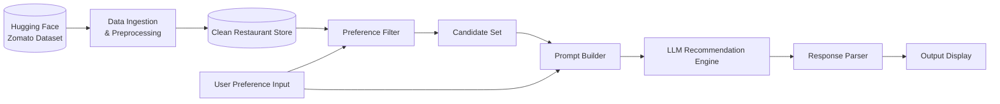
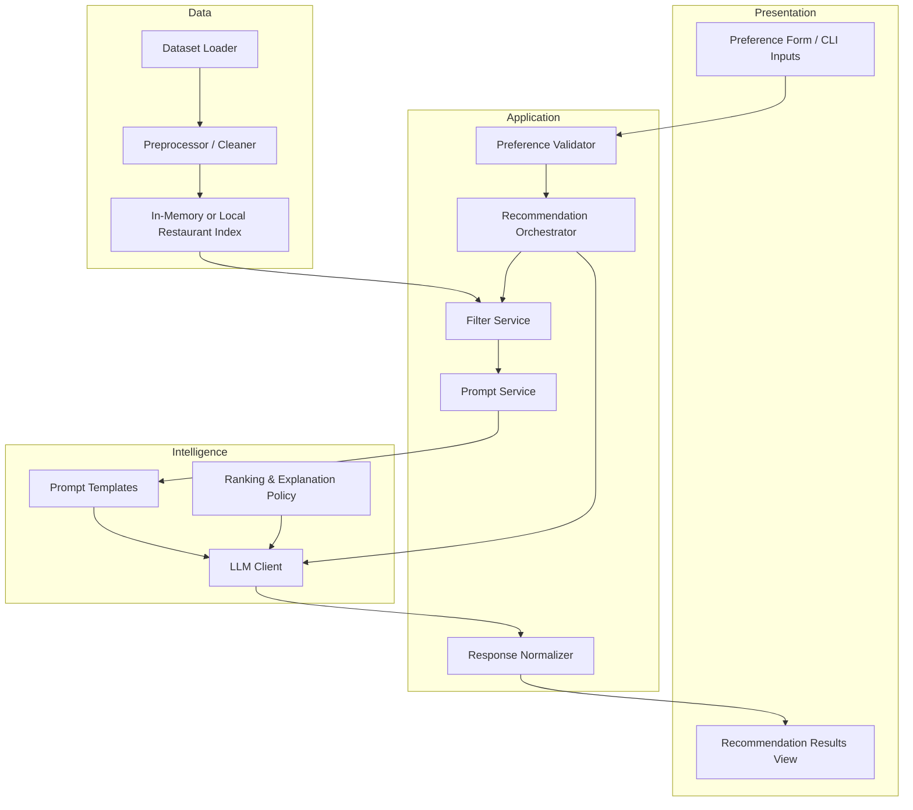
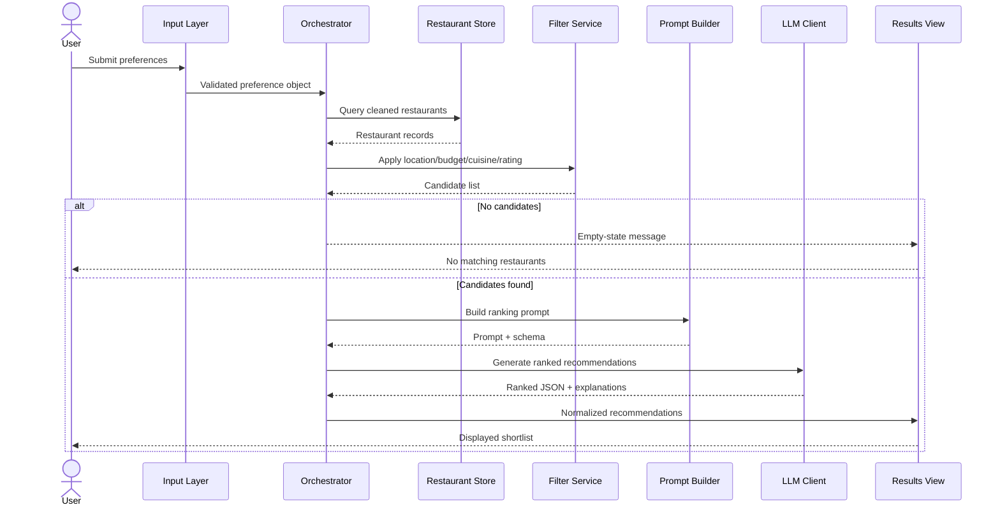
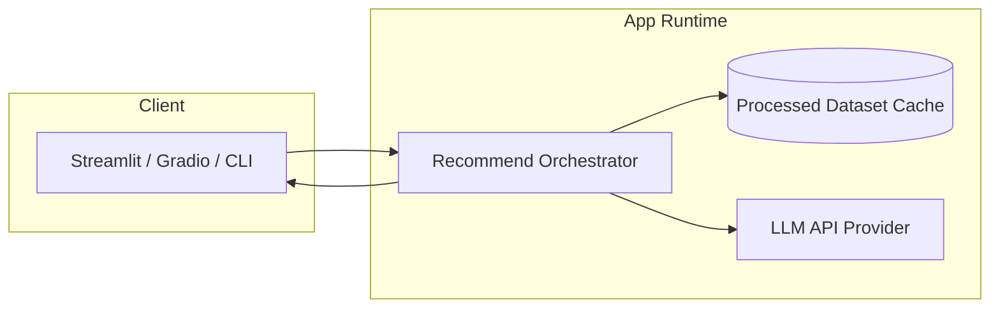
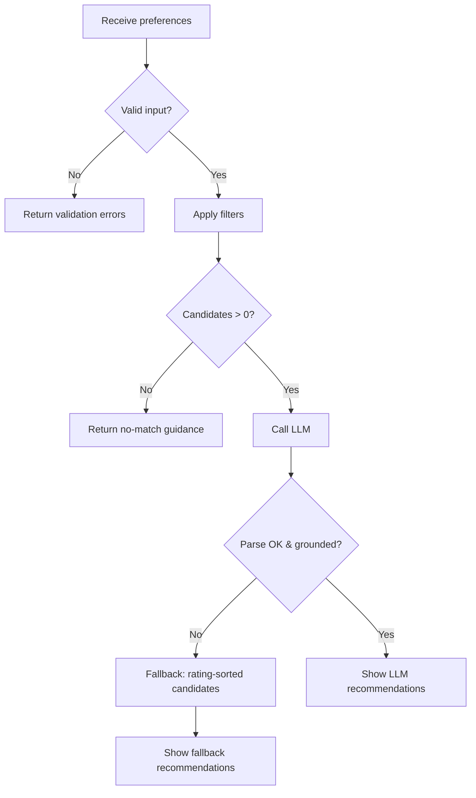

# Architecture — Zomato Restaurant Recommendation System

## 1. Purpose

This document defines the system architecture for an LLM-powered restaurant recommendation pipeline. The system loads Zomato restaurant data from Hugging Face, applies deterministic preference filters, and uses an LLM to rank candidates and generate human-readable explanations.

The architecture separates **hard filtering** (rules/data) from **soft ranking & explanation** (LLM) so recommendations stay grounded in real dataset rows while still feeling personalized.

---

## 2. High-Level Architecture



### Design principle

| Layer | Responsibility | Deterministic? |
|---|---|---|
| Data Ingestion | Load, clean, normalize restaurant records | Yes |
| Preference Filter | Apply hard constraints (location, budget, cuisine, rating) | Yes |
| Prompt Builder | Package candidates + preferences into a structured prompt | Yes |
| LLM Engine | Rank, reason, explain, optionally summarize | No (generative) |
| Output Display | Render structured recommendations to the user | Yes |

Hard constraints never rely on the LLM. The LLM only ranks and explains a **pre-filtered** candidate set.

---

## 3. Component Architecture



### Component responsibilities

#### 3.1 Data Ingestion Module
- Fetch the Zomato dataset from Hugging Face.
- Keep only fields needed for recommendations:
  - `name`
  - `location` / city / locality
  - `cuisine`
  - `cost` / average cost for two
  - `rating`
- Clean nulls, normalize cuisine strings, map cost into budget bands (`low` / `medium` / `high`).
- Persist or cache a cleaned table for repeated queries.

#### 3.2 User Input Module
Collect and validate:

| Field | Type | Notes |
|---|---|---|
| Location | string | City / area match against dataset |
| Budget | enum | `low`, `medium`, `high` |
| Cuisine | string / list | Exact or fuzzy match |
| Minimum rating | number | e.g. `>= 4.0` |
| Additional preferences | free text | Passed to LLM (e.g. family-friendly, quick service) |

Invalid or empty required fields should fail fast before filtering.

#### 3.3 Integration / Filter Layer
- Apply deterministic filters on the cleaned store.
- Produce a bounded candidate set (e.g. top N by rating after filters, or max K rows) to keep LLM context small.
- If zero candidates remain, return a graceful “no match” response without calling the LLM.

#### 3.4 Prompt Builder
Construct a prompt that includes:
1. System role: restaurant recommendation assistant
2. User preferences (structured + free-text)
3. Candidate restaurants as compact structured records
4. Output contract: ranked list with explanations in a parseable format (JSON preferred)

#### 3.5 Recommendation Engine (LLM)
- Rank candidates by fit to preferences.
- Explain each choice in natural language.
- Optionally produce a short overall summary.
- Must not invent restaurants outside the provided candidate list.

#### 3.6 Output Display
Render for each recommendation:
- Restaurant name
- Cuisine
- Rating
- Estimated cost
- AI-generated explanation

Optionally show a one-paragraph summary of the shortlist.

---

## 4. End-to-End Data Flow



### Stage-by-stage flow

1. **Load once** — Dataset ingested and cleaned at startup or via a one-time prep script.
2. **Accept preferences** — User submits structured + free-text preferences.
3. **Filter** — Hard filters shrink the full dataset to a candidate subset.
4. **Prompt** — Candidates and preferences are serialized into an LLM prompt.
5. **Infer** — LLM returns ranked items and explanations.
6. **Normalize** — Parser validates IDs/names against the candidate set; drops hallucinated rows.
7. **Display** — UI/CLI shows the final shortlist.

---

## 5. Logical Modules & Suggested Layout

```text
Zomato/
├── Docs/
│   ├── problemStatement.md
│   └── architecture.md
├── data/
│   ├── raw/                  # optional local cache of HF extract
│   └── processed/            # cleaned restaurant table
├── src/
│   ├── ingestion/
│   │   ├── load_dataset.py
│   │   └── preprocess.py
│   ├── preferences/
│   │   └── schema.py         # preference model + validation
│   ├── filtering/
│   │   └── filter_restaurants.py
│   ├── llm/
│   │   ├── prompt_templates.py
│   │   ├── client.py
│   │   └── parse_response.py
│   ├── orchestrator/
│   │   └── recommend.py      # end-to-end pipeline
│   └── ui/
│       └── app.py            # Streamlit / Gradio / CLI
├── prompts/
│   └── recommend_system.txt
└── requirements.txt
```

Exact stack choices can vary; the module boundaries above should stay stable.

---

## 6. Data Model

### 6.1 Restaurant record (post-processing)

```json
{
  "id": "rest_1024",
  "name": "Truffles",
  "location": "Bangalore",
  "locality": "Koramangala",
  "cuisines": ["Cafe", "American", "Burger"],
  "cost_for_two": 900,
  "budget_band": "medium",
  "rating": 4.5
}
```

### 6.2 User preference object

```json
{
  "location": "Bangalore",
  "budget": "medium",
  "cuisine": "Italian",
  "min_rating": 4.0,
  "additional_preferences": "family-friendly, not too crowded"
}
```

### 6.3 Recommendation result object

```json
{
  "summary": "Here are family-friendly Italian picks in Bangalore within a medium budget.",
  "recommendations": [
    {
      "id": "rest_1024",
      "name": "Truffles",
      "cuisine": "American, Burger",
      "rating": 4.5,
      "estimated_cost": 900,
      "rank": 1,
      "explanation": "Strong rating and casual setting that fits a family outing on a medium budget."
    }
  ]
}
```

---

## 7. Filtering Strategy

Filters run **before** the LLM:

| Filter | Rule |
|---|---|
| Location | Case-insensitive match on city/locality fields |
| Budget | Map dataset cost → `low` / `medium` / `high`, then equality match |
| Cuisine | Substring / token match against cuisine list |
| Minimum rating | `rating >= min_rating` |

### Candidate capping
After filters, keep at most **K** restaurants (recommended default: 15–25) sorted by rating descending. This:
- reduces token cost
- improves latency
- lowers hallucination risk

### Budget banding (example)

| Band | Example cost-for-two range |
|---|---|
| low | < 500 |
| medium | 500–1500 |
| high | > 1500 |

Exact thresholds should be tuned to the chosen dataset’s distribution.

---

## 8. LLM Integration Design

### 8.1 Prompt structure

```text
[SYSTEM]
You are a restaurant recommendation assistant.
Only recommend from the provided candidate list.
Return valid JSON matching the schema.
Do not invent restaurants, ratings, or costs.

[USER]
Preferences: {...}
Candidates: [{...}, {...}]
Task: Rank the best matches and explain each choice.
Also provide a short overall summary.
```

### 8.2 Guardrails
- **Grounding:** Every returned restaurant must map to a candidate `id` or exact `name`.
- **Schema validation:** Reject/repair malformed LLM JSON.
- **Fallback:** If LLM fails, show top filtered candidates by rating with a generic reason (“Matched your filters; ranked by rating”).
- **No open-world search:** LLM cannot browse the web or invent venues.

### 8.3 Why hybrid (filter + LLM)?
- Filters enforce correctness and cost control.
- LLM handles nuanced preferences (“quiet”, “date night”, “family-friendly”) that are hard to encode as columns.
- Explanations improve trust and usability.

---

## 9. Runtime Architecture (Suggested)



### Suggested technology choices

| Concern | Option |
|---|---|
| Language | Python |
| Dataset access | `datasets` (Hugging Face) + `pandas` |
| UI | Streamlit or Gradio (fast demo) / CLI for minimal path |
| LLM | Groq hosted API (`groq` SDK; default `openai/gpt-oss-20b`) |
| Config | `.env` for API keys; YAML/JSON for thresholds |
| Packaging | `requirements.txt` or `pyproject.toml` |

Architecture does not require a database for the MVP; a processed Parquet/CSV plus in-memory DataFrame is enough.

---

## 10. Non-Functional Considerations

| Concern | Approach |
|---|---|
| Latency | Cache cleaned dataset; limit candidates; keep prompts compact |
| Cost | Cap candidate count; reuse templates; avoid unnecessary LLM calls |
| Reliability | Validate LLM output; deterministic fallback ranking |
| Privacy | Do not log raw API keys; treat user preferences as transient |
| Reproducibility | Pin dataset revision / local snapshot when possible |
| Observability | Log filter counts, candidate size, LLM latency, parse failures |

---

## 11. Error & Edge-Case Handling (Architectural View)



Key edge cases the architecture must support:
- Missing/null ratings or costs in source data
- Cuisine spelling variants
- Over-constrained preferences (zero matches)
- LLM timeout / invalid JSON / hallucinated names
- Very large candidate sets after weak filters

---

## 12. Security Boundaries

- API keys stay in environment variables, never in prompts or client-side code.
- User free-text preferences are treated as untrusted input (prompt-injection aware template design).
- Dataset files are read-only during inference.
- Output renderer must not execute model-generated code/HTML unsafely.

---

## 13. MVP vs Later Extensions

### MVP (in scope)
- HF dataset load + clean
- Preference form
- Deterministic filters
- LLM rank + explain
- Results display

### Optional later extensions
- Embedding-based semantic retrieval before LLM
- User session history / personalization memory
- Map view of restaurant localities
- Multi-city comparison
- Feedback loop (“more like this”)

---

## 14. Architecture Summary

The system is a **hybrid recommendation pipeline**:

1. **Data plane** — Hugging Face Zomato data cleaned into a local restaurant store.
2. **Control plane** — User preferences drive deterministic filters.
3. **Intelligence plane** — LLM ranks and explains only the filtered candidates.
4. **Presentation plane** — Structured results with name, cuisine, rating, cost, and explanation.

This separation keeps recommendations factual, explainable, and cost-efficient while still delivering personalized, human-like guidance.
