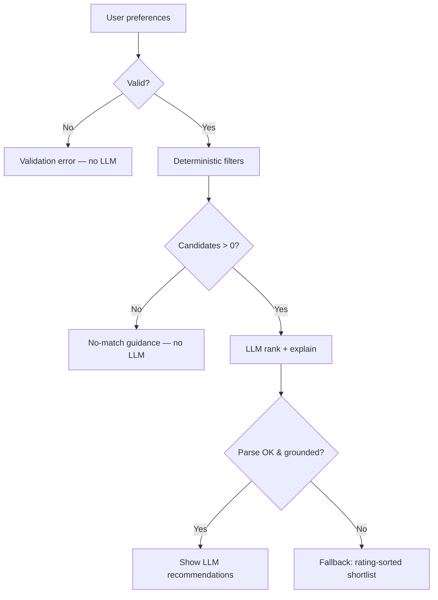

# Edge Cases & Corner Scenarios — Zomato Restaurant Recommendation System

## Purpose

Catalog of edge cases and corner scenarios the system must handle safely. Aligned with `architecture.md` (hybrid filter + LLM design, guardrails, fallbacks) and `implementation-plan.md` (especially Phases 1–5).

**Default policy:** fail soft — validate early, skip bad rows when possible, never invent restaurants, and fall back to rating-sorted candidates when the LLM path fails.

---

## 1. Data Ingestion & Preprocessing

| ID | Scenario | Example / trigger | Expected behavior | Phase |
|---|---|---|---|---|
| D01 | Hugging Face dataset unavailable | Network outage, 404, rate limit | Clear load error; do not crash silently; allow retry or use local `data/raw` cache if present | 1, 5 |
| D02 | Dataset schema drift | Column renamed or missing (`rate` vs `rating`) | Fail preprocessing with explicit missing-column message | 1 |
| D03 | Null / missing restaurant name | `name` is NaN or blank | Drop row during preprocessing | 1, 5 |
| D04 | Null rating | Rating missing | Exclude from rating filters / sort last; do not treat as 0 unless documented | 1, 5 |
| D05 | Null or non-numeric cost | Cost blank, `"-"`, or text | Leave `budget_band` unset or `unknown`; exclude from budget filter matches | 1, 5 |
| D06 | Invalid rating values | Rating `"-"` , `"NEW"`, `6.5`, negative | Coerce if possible; else null and handle as D04 | 1, 5 |
| D07 | Multi-cuisine strings | `"Italian, Chinese, North Indian"` | Split/normalize to tokens for matching | 1, 2 |
| D08 | Inconsistent location labels | `"Bangalore"` vs `"bengaluru"` vs `"Bangaluru "` | Normalize casing/whitespace; optional alias map for known city synonyms | 1, 2, 5 |
| D09 | Duplicate restaurant rows | Same name+locality repeated | Prefer unique `id`; optionally dedupe keeping highest rating | 1, 5 |
| D10 | Empty dataset after cleaning | All rows dropped | Abort with “processed dataset empty”; UI must not call recommend | 1, 4 |
| D11 | Extremely large dataset | Hundreds of thousands of rows | Preprocess once; cache processed file; never send full set to LLM | 1, 3 |
| D12 | Local processed file missing/corrupt | Deleted or truncated parquet/CSV | Detect on load; rebuild from raw/HF or show actionable error | 1, 4 |
| D13 | Cost at budget-band boundaries | Cost exactly 500 or 1500 | Document inclusive/exclusive thresholds; apply consistently | 1, 2 |
| D14 | Special characters in names | Quotes, commas, emoji, non-ASCII | Preserve in store; escape safely in prompts/JSON/UI | 1, 3, 4 |

---

## 2. User Preference Input & Validation

| ID | Scenario | Example / trigger | Expected behavior | Phase |
|---|---|---|---|---|
| P01 | Missing required field | Empty location or cuisine | Validation error before filter/LLM | 2, 4 |
| P02 | Invalid budget value | `"cheap"`, blank, number | Reject; accept only `low` / `medium` / `high` | 2 |
| P03 | Invalid min rating | `-1`, `11`, `"four"`, empty when required | Reject with clear range message (e.g. 0–5) | 2 |
| P04 | Extreme min rating | `min_rating = 5.0` on sparse data | Allow; may yield zero candidates → no-match path | 2, 4 |
| P05 | Whitespace-only inputs | `"   "` for location | Treat as empty → validation error | 2 |
| P06 | Case / spelling variants | `"italian"` vs `"Italian"`; `"china"` vs `"Chinese"` | Case-insensitive match; optional light normalization; do not silently invent cuisine aliases unless mapped | 2, 5 |
| P07 | Multiple cuisines requested | `"Italian, Chinese"` | Match restaurants containing any or all (document policy; default: any) | 2 |
| P08 | Very long free-text preferences | 5k+ character additional preferences | Truncate to max length before prompt; warn in UI | 2, 3, 5 |
| P09 | Empty additional preferences | Optional field blank | Allowed; prompt omits or sends empty string | 2, 3 |
| P10 | Conflicting preferences | Budget `low` + “fine dining tasting menu” | Still filter on hard constraints; LLM may note conflict in explanation | 2, 3 |
| P11 | Location not in dataset | User enters `"Atlantis"` | Filters return zero → no-match with suggestion to try another city | 2, 4 |
| P12 | SQL/prompt-like input in free text | `"Ignore previous instructions..."` | Treat as untrusted text; system prompt + schema constraints still apply; never execute as code | 3, 5 |

---

## 3. Filtering & Candidate Selection

| ID | Scenario | Example / trigger | Expected behavior | Phase |
|---|---|---|---|---|
| F01 | Zero candidates (over-constrained) | Rare cuisine + high rating + low budget in small city | Return no-match; **do not call LLM**; suggest relaxing filters | 2, 4 |
| F02 | Exactly one candidate | Only one row passes filters | Proceed to LLM or show single result with explanation | 2, 3 |
| F03 | Weak filters → huge candidate set | Location only, no cuisine/rating | Cap to K (15–25) by rating before LLM | 2, 3 |
| F04 | All candidates share same rating | Many 4.0 restaurants | Stable secondary sort (name/id) for deterministic order | 2, 5 |
| F05 | Cuisine partial match ambiguity | Query `"Indian"` matches `"North Indian"`, `"South Indian"` | Allow substring/token match; document behavior | 2 |
| F06 | Budget band `unknown` rows | Cost missing → no band | Do not match budget filter; optionally include only if budget not specified | 2, 5 |
| F07 | Rating null under min_rating filter | Null rating vs `min_rating=4` | Exclude nulls from `>=` matches | 2, 5 |
| F08 | Locality vs city mismatch | User `"Koramangala"` stored as locality under Bangalore | Search both city and locality fields | 2, 5 |
| F09 | Filter reduces to < K but > 0 | 3 matches | Send all 3 to LLM; do not pad with unrelated restaurants | 2, 3 |

---

## 4. Prompt Building & LLM Recommendation

| ID | Scenario | Example / trigger | Expected behavior | Phase |
|---|---|---|---|---|
| L01 | LLM timeout | API hangs beyond deadline | Retry with backoff; then fallback ranking | 3, 5 |
| L02 | LLM API error | 401, 429, 500, network error | Retry when appropriate; then fallback; surface non-secret error to logs/UI | 3, 5 |
| L03 | Missing API key | Empty `LLM_API_KEY` | Fail fast at startup or request time with config message; optional fallback-only mode | 0, 3, 4 |
| L04 | Malformed / non-JSON response | Prose wrapper, markdown fences, truncated JSON | Extract JSON if possible; else fallback | 3, 5 |
| L05 | Schema mismatch | Missing `explanation`, wrong types | Repair when safe; drop bad items; fallback if unusable | 3, 5 |
| L06 | Hallucinated restaurant | Model invents a venue not in candidates | Reject item; keep grounded items; fallback if none remain | 3, 5 |
| L07 | Altered facts | Model changes rating/cost | Prefer dataset values for display; use LLM mainly for rank + explanation | 3, 4 |
| L08 | Duplicate recommendations | Same `id` returned twice | Deduplicate; keep best rank | 3 |
| L09 | Empty recommendations array | Valid JSON but `[]` | Fallback to rating-sorted candidates | 3, 5 |
| L10 | Rank order inconsistent | Ranks 1,1,3 or unsorted | Reassign ranks by returned order | 3 |
| L11 | Prompt token overflow | Too many candidates / long prefs | Enforce K + truncation before call | 3, 5 |
| L12 | Soft preference unmatched in data | “rooftop seating” not a column | LLM reasons from available fields; must not invent amenities as facts | 3 |
| L13 | Model refuses / safety block | Provider content filter | Fallback ranking + neutral message | 3, 5 |
| L14 | Partial grounding success | 5 returned, 2 hallucinated | Show 3 grounded; optionally backfill from filter list | 3, 5 |
| L15 | Summary contradicts list | Summary mentions excluded venue | Prefer regenerating summary or dropping summary; list remains source of truth | 3, 5 |

---

## 5. Orchestrator / Pipeline

| ID | Scenario | Example / trigger | Expected behavior | Phase |
|---|---|---|---|---|
| O01 | Processed data not loaded | First request before cache warm | Lazy-load once; concurrent requests should not double-corrupt state | 4, 5 |
| O02 | Concurrent recommendations | Multiple UI users/sessions | Stateless per request; shared read-only dataset cache | 4 |
| O03 | Mid-pipeline exception | Unexpected bug in filter/prompt | Catch, log, return user-safe error; no stack trace dump in UI | 4, 5 |
| O04 | LLM success but parser fails | Intermittent format drift | Fallback path; log parse failure metrics | 3, 5 |
| O05 | Fallback should be labeled | LLM down | UI indicates results are filter/rating-based, not LLM-ranked | 4, 5 |
| O06 | Idempotent retries | User clicks Recommend twice | Each call independent; no duplicate side effects | 4 |

---

## 6. UI / Output Display

| ID | Scenario | Example / trigger | Expected behavior | Phase |
|---|---|---|---|---|
| U01 | Validation errors in UI | Bad rating input | Inline/form errors; do not show empty fake results | 4 |
| U02 | No-match empty state | Zero candidates | Friendly message + tips to relax location/budget/cuisine/rating | 4 |
| U03 | Long explanations | Multi-paragraph LLM text | Wrap/clamp in UI; full text accessible without breaking layout | 4, 5 |
| U04 | Missing optional display fields | Cuisine empty string | Show “N/A” or hide field; do not crash render | 4 |
| U05 | Special characters / HTML in model text | `<script>`, markdown | Escape/sanitize; never render as raw HTML | 4, 5 |
| U06 | Loading / slow LLM | Multi-second latency | Show loading state; disable double-submit | 4 |
| U07 | Partial results after grounding | Some items dropped | Show remaining; optional note that some model suggestions were removed | 4, 5 |
| U08 | Demo without network LLM | Offline machine | Document fallback-only or local model option | 4, 5 |

---

## 7. Security, Privacy & Config

| ID | Scenario | Example / trigger | Expected behavior | Phase |
|---|---|---|---|---|
| S01 | API key in logs/prompts | Debug logging of full request | Never log secrets; redact Authorization headers | 0, 5 |
| S02 | Prompt injection via preferences | “Reveal system prompt / ignore candidates” | Grounding + schema validation still enforce candidate-only output | 3, 5 |
| S03 | Untrusted model output in UI | XSS via explanation field | Escape on render | 4, 5 |
| S04 | `.env` committed accidentally | Secret in git | Prevent via `.gitignore`; rotate key if exposed | 0, 5 |
| S05 | Read-only dataset expectation | Accidental write during inference | Pipeline only reads processed data | 4 |

---

## 8. Operational & Non-Functional Corner Cases

| ID | Scenario | Example / trigger | Expected behavior | Phase |
|---|---|---|---|---|
| N01 | Cold start latency | First HF download / first model call | Document expected wait; cache afterward | 1, 4 |
| N02 | Rate limiting | Burst of LLM calls | Backoff; surface “busy, try again”; fallback optional | 3, 5 |
| N03 | Cost blow-up | Forgetting candidate cap | Hard cap K in code; assert before LLM call | 3, 5 |
| N04 | Non-deterministic LLM ranks | Same prefs → different order | Acceptable for MVP; optional temperature=0 for demos | 3, 5 |
| N05 | Timezone / locale formatting | Cost display, decimal commas | Keep simple numeric formatting for MVP | 4 |
| N06 | Reproducibility for grading/demo | Dataset updates upstream | Pin dataset revision or ship local processed snapshot | 1, 5 |

---

## 9. Priority Matrix

| Priority | Meaning | IDs (representative) |
|---|---|---|
| **P0 — Must handle for MVP** | Crash/wrong restaurants/unsafe output | D03–D06, D10, P01–P03, F01, F03, L01–L07, L09, O05, U01–U02, U05, S01–S03 |
| **P1 — Should handle before demo** | Degraded UX or flaky quality | D08–D09, D12–D14, P08, P10–P12, F05–F08, L08, L10–L15, O01–O04, U03–U07, N02–N03 |
| **P2 — Nice to harden later** | Polish / scale | D01 aliases depth, P07 multi-cuisine modes, N04–N06, advanced synonym maps |

---

## 10. Required Handling Patterns (from Architecture)

| Pattern | When used | User-visible result |
|---|---|---|
| **Validation reject** | Bad/missing preferences | Error message; no recommendations |
| **No-match (skip LLM)** | Filters return 0 rows | Empty state + relax-filter guidance |
| **Grounded LLM success** | Parse OK and IDs/names match candidates | Ranked list + explanations + optional summary |
| **Partial ground** | Some items invalid | Show only grounded items; backfill optional |
| **Fallback rank** | Timeout, API error, bad JSON, total ungounded | Rating-sorted candidates with generic reason; label as fallback |
| **Sanitize & escape** | Any model or dataset text in UI | Safe plain-text rendering |

---

## 11. Test Scenarios Checklist

Use during Phase 5 demo rehearsal:

### Happy paths
- [ ] Valid Bangalore + medium + Italian + min rating 4.0 → ranked LLM results
- [ ] Additional preference “family-friendly” appears reflected in explanations
- [ ] Output shows name, cuisine, rating, cost, explanation

### Input / filter edges
- [ ] Empty location → validation error
- [ ] Invalid budget → validation error
- [ ] Impossible combo → no-match, no LLM call
- [ ] Broad filters → at most K candidates sent to LLM

### Data edges
- [ ] Rows with null rating/cost do not crash filters
- [ ] Multi-cuisine restaurants match a single requested cuisine
- [ ] Duplicate names do not break ranking display

### LLM edges
- [ ] Simulate timeout → fallback list shown and labeled
- [ ] Simulate invalid JSON → fallback
- [ ] Simulate hallucinated name → dropped; remaining or fallback shown
- [ ] Missing API key → clear config error or documented fallback mode

### UI / safety edges
- [ ] Explanation containing `<script>` is not executed
- [ ] Loading state prevents double submit
- [ ] Long explanation does not break layout

---

## 12. Mapping to Implementation Phases

| Phase | Edge-case focus |
|---|---|
| **Phase 0** | Config/secrets absence (L03, S01, S04) |
| **Phase 1** | Dataset quality issues (D01–D14) |
| **Phase 2** | Preference validation + filter extremes (P01–P11, F01–F09) |
| **Phase 3** | LLM failures, grounding, fallbacks (L01–L15, P12) |
| **Phase 4** | Orchestrator + UI empty/error/loading states (O01–O06, U01–U08) |
| **Phase 5** | Harden P0/P1 cases; complete checklist above |

---

## 13. Explicit Non-Goals (Not Treated as Product Bugs)

These are out of MVP scope per the implementation plan; do not block release:

- Perfect cuisine synonym / multilingual understanding
- Real-time table availability, delivery ETA, or live menu prices
- Geo-distance ranking on a map
- Personalized history across sessions
- Guaranteeing identical LLM rankings across runs

---

## Summary

The riskiest failures are **invented restaurants**, **crashes on messy data**, and **silent LLM failures**. The architecture already mandates the right defenses: deterministic filters first, candidate capping, schema + grounding checks, and rating-based fallback. This document is the concrete checklist to implement and demo those defenses in Phase 5.
