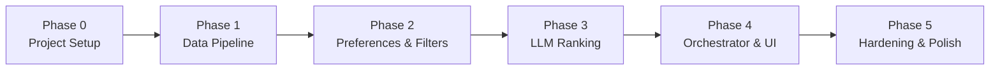

# Implementation Plan — Zomato Restaurant Recommendation System

## Purpose

Phase-wise plan to build the hybrid recommendation pipeline defined in `problemStatement.md` and `architecture.md`: ingest Zomato data from Hugging Face, filter by user preferences, rank and explain with an LLM, and display results.

Each phase has **goals**, **tasks**, **deliverables**, and **exit criteria**. Do not start the next phase until the current exit criteria are met.

---

## Phase Overview



| Phase | Focus | Outcome |
|---|---|---|
| 0 | Repo, env, dependencies | Runnable empty project skeleton |
| 1 | Dataset load + clean | Processed restaurant store |
| 2 | Preference schema + filters | Deterministic candidate shortlist |
| 3 | Prompts + LLM client + parser | Ranked, explained recommendations |
| 4 | End-to-end orchestrator + UI | Working demo |
| 5 | Edge cases, fallbacks, docs | Reliable MVP |

---

## Phase 0 — Project Setup

### Goals
- Create a clean, reproducible project skeleton aligned with the architecture layout.
- Establish config and secrets handling before any API work.

### Tasks
1. Initialize the repo structure:

```text
Zomato/
├── Docs/
├── data/raw/
├── data/processed/
├── src/
│   ├── ingestion/
│   ├── preferences/
│   ├── filtering/
│   ├── llm/
│   ├── orchestrator/
│   └── ui/
├── prompts/
├── .env.example
├── requirements.txt
└── README.md
```

2. Add Python dependencies (`datasets`, `pandas`, LLM client SDK, UI framework such as Streamlit/Gradio, `python-dotenv`, etc.).
3. Create `.env.example` with placeholders for `LLM_API_KEY`, model name, and dataset id.
4. Add a minimal `README.md` with setup steps (install, env, run).
5. Verify a hello-world script imports cleanly.

### Deliverables
- Folder skeleton
- `requirements.txt`
- `.env.example`
- Basic README

### Exit criteria
- [x] `pip install -r requirements.txt` succeeds in a fresh venv
- [x] No secrets committed; env vars documented
- [x] Project layout matches architecture module boundaries

---

## Phase 1 — Data Ingestion & Preprocessing

### Goals
- Load the Zomato dataset from Hugging Face.
- Produce a cleaned, recommendation-ready restaurant table.

### Tasks
1. Identify and pin the Hugging Face dataset id / revision.
2. Implement `src/ingestion/load_dataset.py`:
   - Download / load dataset
   - Optional local cache under `data/raw/`
3. Implement `src/ingestion/preprocess.py`:
   - Keep fields: name, location/locality, cuisine, cost, rating
   - Drop unusable rows (missing name, etc.)
   - Normalize cuisine strings (split, trim, lowercase tokens)
   - Map cost → `budget_band` (`low` / `medium` / `high`)
   - Assign stable restaurant `id`s
4. Save processed output to `data/processed/restaurants.parquet` (or CSV).
5. Add a small script or notebook cell to print row counts, null rates, and budget distribution.

### Deliverables
- Loader + preprocessor modules
- Processed dataset artifact
- Short data-quality summary (printed or logged)

### Exit criteria
- [x] Dataset loads without manual download steps beyond documented setup
- [x] Processed table has required columns and non-empty rows
- [x] Budget bands and ratings are usable for filtering
- [x] Re-running preprocessing is idempotent

---

## Phase 2 — Preferences & Deterministic Filtering

### Goals
- Capture and validate user preferences.
- Apply hard filters to produce a capped candidate set **without** calling the LLM.

### Tasks
1. Define preference schema in `src/preferences/schema.py`:
   - `location`, `budget`, `cuisine`, `min_rating`, `additional_preferences`
2. Add validation (required fields, budget enum, rating range).
3. Implement `src/filtering/filter_restaurants.py`:
   - Location match (city/locality, case-insensitive)
   - Budget band match
   - Cuisine token/substring match
   - `rating >= min_rating`
4. Cap candidates to **K** (default 15–25), sorted by rating descending.
5. Write unit-style checks or a small CLI demo:
   - known-good preferences → non-empty candidates
   - over-constrained preferences → empty set

### Deliverables
- Preference model + validator
- Filter service
- Candidate-list demo (print top K)

### Exit criteria
- [x] Valid preferences produce a filtered shortlist from processed data
- [x] Invalid preferences fail with clear errors
- [x] Empty-candidate path works without LLM involvement
- [x] Candidate count never exceeds K

---

## Phase 3 — LLM Prompting, Ranking & Parsing

### Goals
- Build grounded prompts from preferences + candidates.
- Call an LLM to rank and explain.
- Parse and validate the response against the candidate set.

### Tasks
1. Author prompt templates under `prompts/` (system + user).
2. Implement `src/llm/prompt_templates.py` to inject:
   - structured preferences
   - compact candidate JSON
   - required output schema
3. Implement `src/llm/client.py`:
   - read API key/model from env
   - send chat completion request
   - handle timeouts/basic retries
4. Implement `src/llm/parse_response.py`:
   - extract JSON
   - map returned items to candidate `id`/name
   - drop hallucinated restaurants
   - normalize fields: name, cuisine, rating, cost, rank, explanation, summary
5. Add a fallback ranker: if LLM/parse fails, return rating-sorted candidates with a generic explanation.
6. Manually test 3–5 preference scenarios and inspect explanation quality.

### Deliverables
- Prompt templates
- LLM client
- Response parser + grounding checks
- Fallback ranking path

### Exit criteria
- [x] LLM returns parseable ranked recommendations for valid candidates
- [x] Hallucinated names are rejected
- [x] Fallback activates on LLM/parse failure
- [x] Explanations reference user preferences in plain language

**Provider note:** Phase 3 uses **Groq** (`groq` SDK). Set `LLM_API_KEY` (or `GROQ_API_KEY`) and `LLM_MODEL` (default `openai/gpt-oss-20b`).

---

## Phase 4 — Orchestrator & User Interface

### Goals
- Wire ingestion → filter → LLM → display into one pipeline.
- Ship a simple interactive UI (or polished CLI) for the demo.

### Tasks
1. Implement `src/orchestrator/recommend.py`:
   - load processed data (cache in memory)
   - validate preferences
   - filter → prompt → LLM → parse → normalize
   - return structured result object
2. Build UI in `src/ui/app.py` (Streamlit/Gradio recommended):
   - inputs: location, budget, cuisine, min rating, additional preferences
   - outputs: summary + cards/table with name, cuisine, rating, cost, explanation
   - empty-state and error-state messages
3. Add a one-command run path in README (`streamlit run ...` or equivalent).
4. Smoke-test the full path with at least two cities/cuisines if present in data.

### Deliverables
- End-to-end orchestrator
- Working UI/CLI demo
- Updated run instructions

### Exit criteria
- [x] User can submit preferences and see ranked recommendations in the UI
- [x] Output includes name, cuisine, rating, estimated cost, and AI explanation
- [x] No-match and validation errors are user-visible and non-crashing
- [x] Pipeline runs without manual notebook steps

**Run:** `streamlit run src/ui/app.py` · smoke: `python scripts/test_phase4.py`

---

## Phase 5 — Hardening, Edge Cases & Polish

### Goals
- Make the MVP reliable under messy data and model failures.
- Finalize documentation for handoff/demo.

### Tasks
1. Handle data edge cases:
   - null ratings/costs
   - cuisine spelling variants
   - duplicate restaurant names
2. Harden LLM path:
   - retries with backoff
   - stricter JSON schema instructions
   - clearer fallback messaging
3. Tune filter thresholds (budget bands, K, default min rating).
4. Add lightweight logging: candidate count, LLM latency, parse success/failure.
5. Write/refresh docs:
   - README quickstart
   - link `Docs/problemStatement.md`, `architecture.md`, this plan
   - optional `Docs/edge-case.md`
6. Do a demo rehearsal checklist (happy path + no-match + LLM failure simulation).

### Deliverables
- More robust pipeline
- Logging for key steps
- Demo-ready README + docs

### Exit criteria
- [ ] Common edge cases do not crash the app
- [ ] Fallback path is demonstrable
- [ ] README alone is enough to run the project
- [ ] MVP scope from the problem statement is fully covered

---

## Cross-Phase Engineering Rules

1. **Filter before LLM** — never send the full dataset to the model.
2. **Ground all recommendations** — every shown restaurant must exist in the candidate set.
3. **Fail soft** — prefer fallback ranking over a hard crash.
4. **Keep modules thin** — ingestion, filtering, LLM, UI stay separable.
5. **No secrets in git** — API keys only via `.env`.
6. **Ship vertical slices** — each phase should leave something runnable/demoable.

---

## Suggested Milestone Checklist

| Milestone | Phase gate | Demoable artifact |
|---|---|---|
| M0 | Phase 0 done | Project installs cleanly |
| M1 | Phase 1 done | Cleaned restaurant table |
| M2 | Phase 2 done | Filtered shortlist from preferences |
| M3 | Phase 3 done | LLM explanations for a shortlist |
| M4 | Phase 4 done | Full UI recommendation flow |
| M5 | Phase 5 done | Reliable MVP demo |

---

## Out of Scope for This Plan (Deferred)

- Embedding-based semantic retrieval
- Persistent user profiles / history
- Maps and geo search UI
- Production auth, billing, or multi-tenant deployment
- Building a full food-delivery marketplace

These may follow after M5 if needed; they are not required to satisfy the current problem statement.

---

## Immediate Next Step

Start **Phase 5**: harden edge cases, logging, fallback messaging, and polish the README for a reliable demo.
